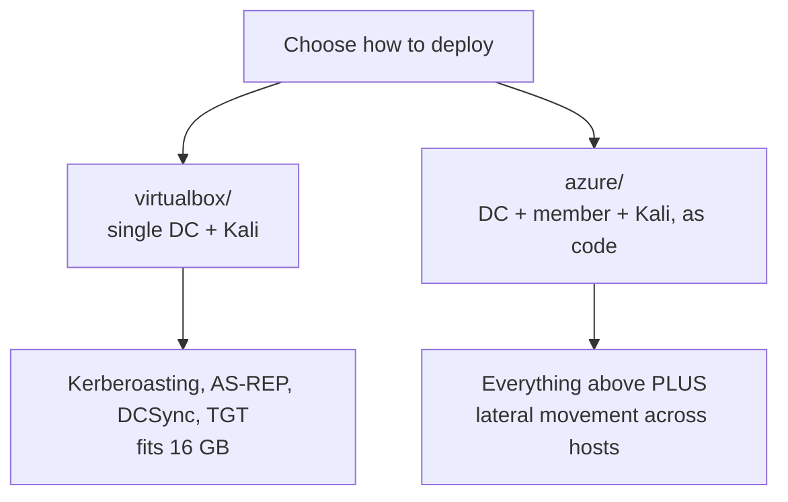

# ad-attack-lab

A vulnerable **Active Directory (AD)** attack range for OSCP practice, with two
deployments of the *same* attacks: a RAM-light **single DC on VirtualBox** and a
full multi-host **chain on Azure** (as code). Built by ShabangTech.

> **Acronyms:** AD = Active Directory · DC = Domain Controller · IaC =
> Infrastructure as Code · VNet = Virtual Network · NSG = Network Security Group
> (per-VM firewall) · RDP = Remote Desktop Protocol.

## What you practice

Kerberoasting · AS-REP roasting · DCSync · TGT abuse (Pass-the-Ticket) ·
Pass-the-Hash · lateral movement (PsExec/WMI between hosts).

## Pick your deployment



| Deployment | Hosts | What it covers | Cost |
|---|---|---|---|
| **`virtualbox/`** | 1 DC + Kali | Kerberoasting, AS-REP, DCSync, TGT | Free; fits a 16 GB laptop |
| **`azure/`** | DC + member + Kali | All of the above **+ lateral movement** | Azure for Students $100 credit — **deallocate between sessions** |

Start on VirtualBox to drill the techniques; move to Azure when you want the full
multi-host chain your laptop can't hold.

## Safety (read before you deploy)

- The DC is **intentionally vulnerable** — **never expose it to the public internet.**
  The Azure build locks the NSG to **your IP only**; keep it that way.
- **`.gitignore` blocks `*.tfstate*`, `*.tfvars`, and loot** — Terraform state and
  tfvars hold secrets. Never commit them.
- Azure bills compute while a VM is *allocated* — **Stop (deallocate)** when you're
  done, and the included budget alert warns you before the credit runs low.

## Layout

```
ad-attack-lab/
├── virtualbox/single-dc-lab.md   # local single-DC build + attacks
├── azure/                        # Terraform: VNet + NSG + DC + member + Kali + budget
└── detections/                   # purple-team: detect each attack (feeds a SOC)
```

## MITRE ATT&CK

Kerberoasting **T1558.003** · AS-REP roasting **T1558.004** · DCSync **T1003.006** ·
Pass-the-Ticket **T1550.003** · Pass-the-Hash **T1550.002** · lateral movement **T1021**.
